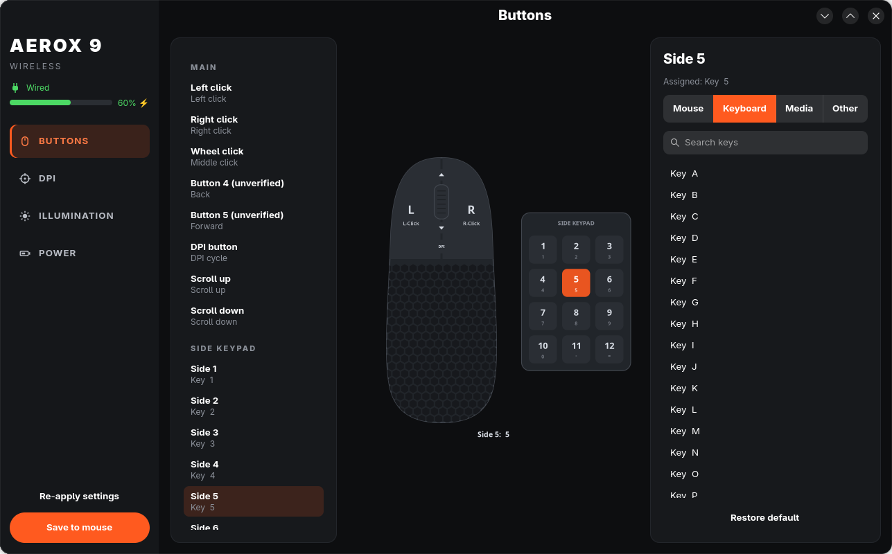
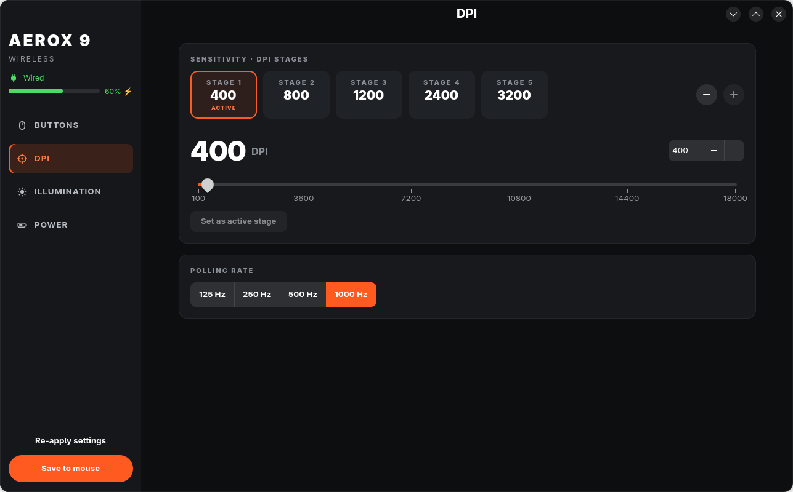
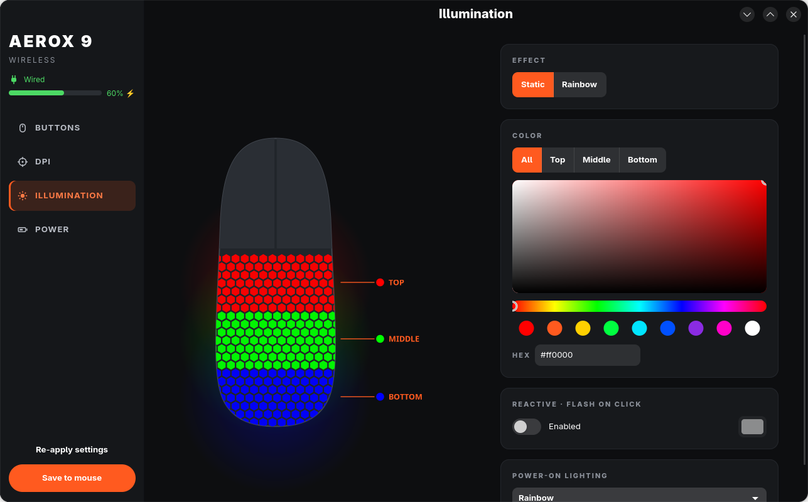
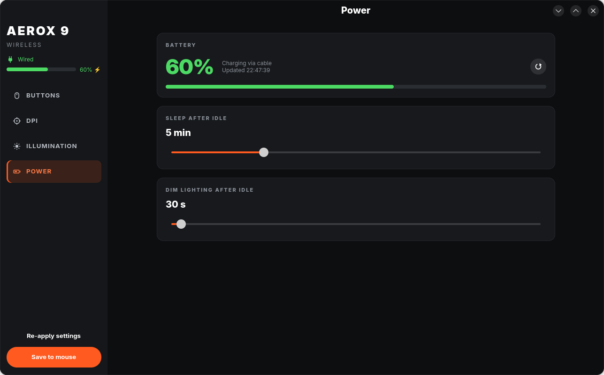

# aerox9-config

GTK4/libadwaita configurator for the SteelSeries Aerox 9 Wireless (wired and 2.4 GHz dongle).
Talks to the mouse directly over `/dev/hidraw*`; no dependencies beyond PyGObject + libadwaita.

> **Personal project.** This is mostly built for my own use, because the Aerox 9 Wireless is the mouse I own.
> It only supports that one model and has only been tested on my setup. Other SteelSeries mice are not
> supported; for those, use [rivalcfg](https://github.com/flozz/rivalcfg).
>
> That said, feel free to copy or fork it and adapt it to your own mouse. The device-specific parts are
> `aerox9/protocol.py` (command bytes) and the product IDs in `aerox9/device.py`.

## Screenshots

### Buttons
Click a button on the mouse or the side keypad, then pick a mouse action, keyboard key, media key or DPI cycle.

### DPI
Up to 5 DPI stages (100–18000) and polling rate.

### Illumination
Static colors for the three LED zones or the rainbow effect, reactive click color and power-on lighting.

### Power
Battery level, sleep timer and LED dim timer.

## Compatibility

Developed and tested only on **Arch Linux** + **KDE Plasma** (GTK 4.24, libadwaita 1.10, Python 3.14).
Other distros are untested, but it should work on any Linux distro that has:

| Requirement | Minimum | Why |
|---|---|---|
| Python | 3.9 | |
| GTK | 4.12 | `Gtk.CssProvider.load_from_string`, `Gtk.ListBox.remove_all` |
| libadwaita | 1.4 (1.6+ for the full dark/orange theme) | `Adw.OverlaySplitView`, `Adw.ToolbarView`; the theme uses libadwaita 1.6 CSS variables, so on 1.4–1.5 some accents fall back to the default blue |
| PyGObject | any recent | |

Packages: Arch `python-gobject gtk4 libadwaita`, Fedora `python3-gobject gtk4 libadwaita`,
Debian/Ubuntu `python3-gi gir1.2-gtk-4.0 gir1.2-adw-1`.
Too old: Debian 12 (GTK 4.8) and Ubuntu 22.04 (no GTK 4.12/libadwaita 1.4); Ubuntu 24.04 and recent Fedora should be fine.

Mouse access uses `/dev/hidraw*`, which systemd-logind normally grants to the logged-in user.
On distros without systemd/logind (e.g. Void, Alpine, Gentoo with OpenRC) add the udev rule from the Notes below.

## Install

    make install      # single-file executable -> ~/.local/bin/aerox9
    make uninstall

`aerox9` takes the same subcommands as below.

## Run from source

    python3 -m aerox9            # GUI
    python3 -m aerox9 battery
    python3 -m aerox9 apply [--buttons]   # re-send stored settings
    python3 -m aerox9 save       # persist to onboard memory
    python3 -m unittest tests/test_protocol.py

## Notes

- The mouse can't report its settings, so `~/.config/aerox9/settings.json` is the source of truth.
  Nothing is sent on startup; only settings you touch are sent (live), so onboard config is not overwritten.
- Changes are volatile until you press **Save to mouse** (writes flash).
- Button mapping is **experimental**, from the unmerged rivalcfg PR #243, and only sent when you press Apply
  on the Buttons tab. If something goes wrong, Reset → Apply, or unplug/replug (unsaved changes are lost).
- hidraw access relies on the logind `uaccess` ACL. If you get "permission denied", add a udev rule
  in a file whose number is **below 73**, e.g. `/etc/udev/rules.d/70-aerox9.rules`:

      KERNEL=="hidraw*", ATTRS{idVendor}=="1038", TAG+="uaccess"

  The ACL is applied by systemd's `73-seat-late.rules`, which only acts on devices already tagged
  `uaccess`. A file such as `99-*.rules` runs too late: the tag is set but no ACL is granted.
  Then reload and re-trigger (no replug or re-login needed):

      sudo udevadm control --reload
      sudo udevadm trigger --subsystem-match=hidraw
      getfacl /dev/hidraw*    # should list user:<you>:rw- for the mouse nodes

## Credits

Huge thanks to **[rivalcfg](https://github.com/flozz/rivalcfg)** by
[Fabien LOISON (flozz)](https://github.com/flozz) and its contributors. This project would not exist
without their reverse-engineering work on SteelSeries mice. rivalcfg is not a runtime dependency, but its
source code was used directly as the protocol reference:

| What | rivalcfg source | Used in |
|---|---|---|
| Command bytes and value encodings (DPI, polling rate, LED zones, reactive color, rainbow, default lighting, sleep/dim timers, battery, save) | [`rivalcfg/devices/aerox9_wireless_wired.py`](https://github.com/flozz/rivalcfg/blob/master/rivalcfg/devices/aerox9_wireless_wired.py) and the `handlers/` modules | `aerox9/protocol.py` |
| 2.4 GHz wireless mode (command flag `0x40`, readback) | [`rivalcfg/devices/aerox9_wireless_wireless.py`](https://github.com/flozz/rivalcfg/blob/master/rivalcfg/devices/aerox9_wireless_wireless.py) | `aerox9/protocol.py`, `aerox9/device.py` |
| DPI → sensor code table (copied verbatim) | [`rivalcfg/devices/dpi/truemove_air.py`](https://github.com/flozz/rivalcfg/blob/master/rivalcfg/devices/dpi/truemove_air.py) | `aerox9/protocol.py` |
| Button mapping layout (3-packet `0x2A` command, button offsets) | [PR #243 "Add basic support for aerox 9 buttons"](https://github.com/flozz/rivalcfg/pull/243) by [zebreus](https://github.com/zebreus) | `aerox9/protocol.py` |

rivalcfg is licensed under the [WTFPL](https://github.com/flozz/rivalcfg/blob/master/LICENSE).
If you use a SteelSeries mouse on Linux, go give rivalcfg a ⭐.

## License

aerox9-config is free software: anyone may use, copy, modify and redistribute it,
for any purpose, without restriction.
It comes with no warranty; changing your mouse's settings is at your own risk.
